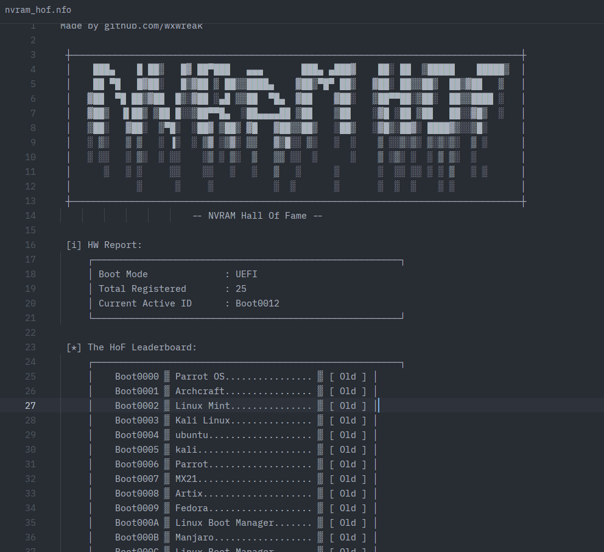

# NVRAM Hall Of Fame

A lightweight Rust utlity that inspects system boot entries using `efibootmgr`, parsers and cleans up the output, checks the firmware boot mode, and generates a retro-style ASCII art report.

## Preview


## Features

- **Boot Parsing:** Automatically runs `efibootmgr -v`, extracts registered boot entries, and strips out verbose UEFI device paths (like `VenHw`, `HD`, `BBS`, or `PciRoot`) for a cleaner view.
- **Active Boot Detection:** Identifies the currently active boot entry (`BootCurrent`) and marks it on the leaderboard.
- **Firmware Detection:** Automatically checks whether the system is booted in **UEFI** or **Legacy** mode via `/sys/firmware/uefi`.

## Requirements
- **Linux**
- ['efibootmgr'](https://github.com/rhboot/efibootmgr)
- **Rust**

## Usage
1. Clone the repo
2. Ensure you have root permissions to read UEFI variables
3. Build and run the project using Cargo:
```bash
cargo run --release
```

## License
This project is licensed under the MIT License. See the [License](LICENSE) file for details.
